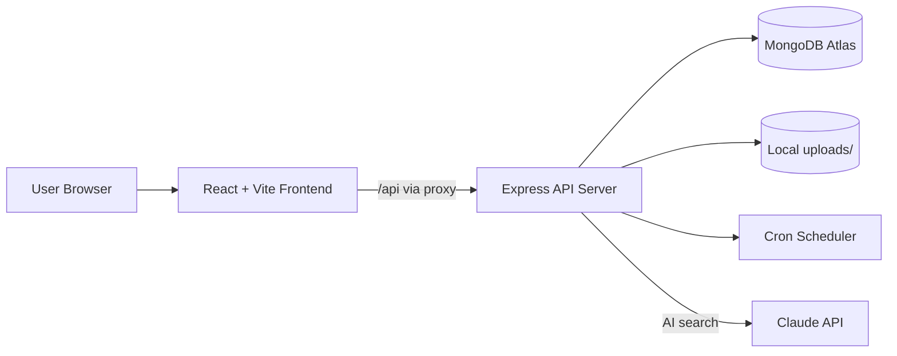

# Fleet Manager

[](LICENSE)

Fleet Manager is a full-stack web application for managing fleet vehicles, maintenance work, and compliance documents with role-based access for Admin and Mechanic users.

## Overview

This project helps fleet teams:

- Register and manage vehicle assets.
- Assign and track maintenance tasks.
- Monitor compliance documents (registration and DOT inspection).
- Export operational data to Excel for reporting.
- Generate vehicle QR codes for quick mechanic access workflows.
- Ask plain-English questions about maintenance history with AI search.

## Key Features

### Authentication and Roles

- Session-based authentication using `express-session`.
- Admin login with password protection.
- Mechanic login with restricted workspace access.
- Role-based API guard middleware for protected routes.

### Admin Dashboard

- Add, view, update, and delete vehicles.
- Set and update vehicle operational status.
- Upload and manage compliance documents.
- Assign maintenance tasks to mechanics.
- View per-vehicle maintenance history.
- Export fleet asset data to Excel (`.xlsx`).
- View live fleet analytics cards:
  - Total vehicles
  - Active vehicles
  - Pending jobs

### Mechanic Portal

- View pending and completed tasks.
- Mark tasks as completed.
- Export maintenance logs to Excel (`.xlsx`).

### Compliance Center

- Upload required compliance files:
  - Copy of Registration
  - Annual DOT Inspection
- Track expiration dates.
- Show automated alert states:
  - Missing
  - Expired
  - Expiring soon (within 30 days)
  - Current

### AI Search

The fleet search bar doubles as an AI assistant, powered by Claude.

- Type a question such as _"When were the brakes last replaced on Unit 57?"_ and press **Enter** or click **Ask AI**.
- Plain searches (unit number, make, VIN) still filter the vehicle cards as before. Input that ends with `?` or has four or more words is treated as a question.
- The backend finds any unit numbers named in the question and sends Claude only those vehicles and their maintenance history. Questions that don't name a unit, such as _"Which vehicles are out of service?"_, get the whole fleet's records.
- Answers come back as one to three conversational sentences, usually within a few seconds.
- Answers are grounded in the records only. If the history doesn't contain the answer, the assistant says so instead of guessing. It matches work by meaning, so it understands task descriptions written in other languages (for example, Spanish).
- A completed task's completion date is taken from when it was last updated, because tasks have no separate completion field.
- Tasks don't record who did the work, so answers never name a mechanic.
- Available to both Admin and Mechanic users.

### Automation

- Daily cron job creates automated PM tasks for active vehicles.

## Tech Stack

### Frontend

- React 19
- Vite
- Lucide React icons
- Sheet export with `xlsx`

### Backend

- Node.js
- Express 5
- MongoDB with Mongoose
- Session management with `express-session`
- File uploads with `multer`
- Scheduled jobs with `node-cron`
- Environment variable loading with `dotenv`
- AI search with the Claude API (`@anthropic-ai/sdk`, model `claude-opus-5-5`)

## Architecture



## Project Structure

```text
fleet-manager/
  server.js
  package.json
  .env
  .env.example
  frontend/
    src/
      components/
    package.json
    vite.config.js
  uploads/
```

## Getting Started

### 1. Prerequisites

- Node.js 18+ recommended
- npm
- MongoDB Atlas connection string
- Claude API key, for AI search (see below)

### 2. Install Dependencies

From the project root:

```bash
npm install
```

From the frontend folder:

```bash
cd frontend
npm install
```

### 3. Configure Environment Variables

In root `.env`:

```env
ADMIN_PASSWORD=your-admin-password
SESSION_SECRET=your-session-secret
MONGO_URI=your-mongodb-connection-string
# Optional fallback if SRV DNS fails in your runtime environment
MONGO_URI_DIRECT=your-direct-mongodb-connection-string
# Claude API key for AI search
ANTHROPIC_API_KEY=your-anthropic-api-key
```

#### QR code links

Each vehicle's QR code links to `/vehicle/<id>`, which opens that vehicle's details and jobs after login. By default the link uses the address the dashboard was opened from, which is correct for the deployed site. When running locally, phones can't reach `localhost`, so create `frontend/.env` with an address the phone can open, and restart Vite:

```env
# Your deployed site, or your computer's network address for local testing
VITE_PUBLIC_APP_URL=https://your-app.vercel.app
```

For local testing over Wi-Fi, use your computer's network address (for example `http://192.168.1.20:5173`) and start the frontend with `npm run dev -- --host`.

### 4. Run the App

Start backend (from root):

```bash
node server.js
```

Start frontend (new terminal):

```bash
cd frontend
npm run dev
```

Open the frontend URL shown by Vite (typically `http://localhost:5173`).

## API Summary

### Auth

- `POST /api/auth/login`
- `GET /api/auth/session`
- `POST /api/auth/logout`

### Vehicles

- `POST /api/vehicles` (Admin)
- `GET /api/vehicles` (Admin/Mechanic)
- `GET /api/vehicles/:id` (Admin/Mechanic)
- `PATCH /api/vehicles/:id` (Admin)
- `DELETE /api/vehicles/:id` (Admin)

### Documents

- `POST /api/vehicles/:vehicleId/documents` (Admin)
- `POST /api/vehicles/:vehicleId/compliance-documents` (Admin)
- `GET /api/vehicles/:vehicleId/compliance-documents` (Admin/Mechanic)

### Tasks

- `POST /api/tasks` (Admin)
- `GET /api/tasks` (Admin/Mechanic)
- `PATCH /api/tasks/:taskId` (Admin/Mechanic)
- `GET /api/vehicles/:vehicleId/tasks` (Admin/Mechanic)

### AI

- `POST /api/ai/ask` (Admin/Mechanic): body `{ "question": "..." }`, up to 500 characters. Returns `{ "answer": "...", "vehicles": ["57"] }`, where `vehicles` lists the units whose records were sent to the model.

## Challenges Solved

- Unified role-based access across frontend and backend route behavior.
- Normalized vehicle identifier handling (`vehicleNumber`, legacy aliases).
- Implemented compliance status logic based on date windows and missing docs.
- Coordinated file upload flow and metadata persistence in MongoDB.
- Added scheduled preventive maintenance generation with cron.
- Added environment-based configuration to avoid hardcoding sensitive values.
- Added AI search that answers questions only from each vehicle's own maintenance records.

## Known Limitations

- Admin password is currently compared in plaintext from env (not hashed in DB).
- No automated test suite yet.
- Upload storage is local filesystem and not cloud/object storage.
- Session cookie is configured for local development (`secure: false`).
- AI search can't say who performed a job, because tasks don't record a mechanic name or a separate completion date.
- Fleet-wide AI questions send every vehicle's history to the model, so cost per question grows with fleet size.

## Roadmap

- Hash and verify admin credentials with bcrypt.
- Move authentication to persisted user accounts with roles.
- Add unit and integration tests.
- Add pagination/filtering for large fleets.
- Store uploads in cloud storage and add signed URL access.
- Add CI workflow for lint/build/test checks.
- Record who completed each task and when, so AI search can answer "who" questions.

## Security Notes

- Keep `.env` out of version control.
- Rotate `SESSION_SECRET` and `ADMIN_PASSWORD` regularly.
- Keep `ANTHROPIC_API_KEY` on the server only. The browser calls `/api/ai/ask`, never the Claude API directly.
- Restrict MongoDB Atlas network and user permissions.
- Use HTTPS and secure cookies in production.

## License

This project is licensed under the Apache License 2.0. See [LICENSE](LICENSE) for details.

---

© 2025 Fleet Asset Tracking. All rights reserved.
